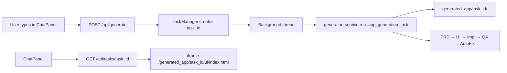

# VibeCoder / LocalForge — Codebase Summary

This is a **read-only analysis** of what actually exists in the repo today. The code consistently uses the name **VibeCoder**; **LocalForge** does not appear in source files (it may be your course or report name).

---

## 1. Project Overview

### What it is trying to build

VibeCoder is an **AI-powered app generator**. A user describes an app in natural language (e.g. “build a todo app” or “make Minesweeper”), and a **multi-agent pipeline** produces a working **vanilla HTML/CSS/JavaScript prototype** that can be previewed in the browser.

Despite `pyproject.toml` saying “React application generator,” the current pipeline builds **static web prototypes** (`ui/index.html`, `ui/css/style.css`, `ui/js/main.js`), not full React/Vite apps. Older `templates/react-simple-spa/` was removed from the repo.

### Problem it solves

- Non-developers (or students) can go from **idea → runnable prototype** without hand-writing code.
- The system adds **structured planning** (PRD), **UI design**, **implementation**, **QA**, and optional **auto-fix**.
- Users can **iterate** with follow-up messages (refine mode).

### Target users

- Students / makers prototyping small web apps quickly.
- Developers experimenting with **multi-agent orchestration** (smolagents + LLMs).
- Demo users who want a chat UI + live preview (Gemini-style layout).

### Does the code match the goal?

**Mostly yes, with gaps:**

| Goal | Status |
|------|--------|
| Natural language → generated app | ✅ Core pipeline works (PRD → UI → Implementation → QA → Auto-fix) |
| Web UI with preview | ✅ React frontend + FastAPI backend (primary path) |
| Multi-agent architecture | ✅ Implemented; two orchestration modes |
| React app generation | ❌ Outdated description; output is vanilla JS |
| Streamlit GUI | ⚠️ `app.py` still exists but is **legacy**; Streamlit is **not** in `pyproject.toml` |
| Stable demo setup | ⚠️ Needs MongoDB, API keys, and correct env vars |

---

## 2. Folder and File Structure

### High-level layout

```
VibeCoder/
├── backend/              # FastAPI server, task/session DB, generation service
├── frontend/             # React + Vite UI (chat + preview)
├── prompts/agents/       # Jinja2 agent prompts (*.j2)
├── am_tools.py           # Shared agent tools (file I/O, validation, state)
├── app_generator.py      # CLI-only generation pipeline
├── vibecoder_engine.py   # OOP wrapper around the same pipeline
├── app.py                # Legacy Streamlit GUI
├── generated_app/        # Output: one folder per generation task (UUID)
├── log/                  # Historical run logs (text files)
└── video/, pic/          # Demo assets (not runtime code)
```

### Most important files

| File | Role |
|------|------|
| `backend/main.py` | **Main API entry** — FastAPI, CORS, static preview mount, `/api/generate`, `/api/refine`, sessions |
| `backend/services/generator_service.py` | **Generation engine for API** — runs full agent pipeline in background threads |
| `backend/services/agent_factory.py` | Builds worker agents (PRD, UI, impl sub-phases, QA, auto-fix) |
| `am_tools.py` | All agent **tools** + `agent_state` sandbox |
| `prompt_loader.py` + `prompts/agents/*.j2` | Agent instructions |
| `frontend/src/components/ChatPanel.tsx` | User input, generation/refine/chat modes |
| `frontend/src/components/PreviewPanel.tsx` | iframe preview of generated apps |
| `app_generator.py` | **CLI entry** — same pipeline without API/frontend |

### Entry points (how you run it)

| Entry | Command (typical) | Purpose |
|-------|-------------------|---------|
| **Primary (modern)** | `uvicorn` / `python backend/main.py` + `npm run dev` in `frontend/` | Full product: React UI + API |
| **CLI** | `python app_generator.py` | Backend-only generation from terminal |
| **Engine class** | Import `VibeCoderEngine` from `vibecoder_engine.py` | Programmatic use / tests |
| **Legacy Streamlit** | `streamlit run app.py` | Old GUI (needs `streamlit` installed separately) |
| **Demo script** | `python orchestration.py` | Unrelated smolagents manager/researcher demo |

### Generated outputs

- **`generated_app/<task_id>/`** — each API generation gets an isolated sandbox:
  - `PRD.md`, `app_spec.json`
  - `ui/index.html`, `ui/css/style.css`, `ui/js/main.js`, `ui/UI_STRUCTURE.json`
  - `code_prototype_test_report.md` (QA)
  - `auto_fix_report.md`, `USER_FEEDBACK.md` (when applicable)
- Root-level artifacts like `implementation_plan.md`, `UI_STRUCTURE.json`, `app_spec.json` at repo root are **leftover samples**, not the live pipeline output.

### Logs

- **`log/*.txt`** — past agent run transcripts (e.g. `mine_sweeper.txt`, `green_to_do.txt`).
- **MongoDB `tasks.logs`** — per-task progress strings during API runs (frontend polls status but does not show full agent logs in the UI).

### Templates

- Prompts reference `templates/react-simple-spa`, but that folder was **deleted**. `copy_template_to_ui_folder()` falls back to creating a minimal HTML/CSS/JS skeleton.

### Prompts

- `prompts/agents/prd_agent.j2` — requirements → PRD + spec
- `ui_agent.j2` — HTML/CSS layout
- `implementation_agent.j2` — JS logic (sequential mode)
- `qa_agent.j2` — test report only
- `auto_fix_agent.j2` — fix bugs from QA
- `refine_agent.j2` — user feedback changes
- `manager_agent.j2` — documented manager role (true LLM manager is optional / partially wired)

### Tools

- **`am_tools.py`** — `read_file`, `write_file`, `mkdir`, `list_files`, path helpers, `validate_implementation`, `analyze_qa_report_for_fixes_needed`, etc.
- All file access is **sandboxed** to `agent_state.base_path`.

### Configuration

- `pyproject.toml` / `uv.lock` — Python deps (smolagents, FastAPI, motor, litellm, etc.)
- `.mcp.json` — MCP server config (Context7); not central to app generation
- Env vars (used in code, no `.env` in repo):
  - `MONGODB_URI` (default `mongodb://localhost:27017/vibecoder_db`)
  - `VIBECODER_FORCE_MODEL_ID` (default `gpt-5.4-2026-03-05`)
  - `GEMINI_API_KEY`, `OPENAI_API_KEY` / provider keys via LiteLLM
  - `USE_MANAGER_ORCHESTRATION` — switches implementation sub-phases
  - `VIBECODER_TEST_FIRST_THREE_AGENTS_ONLY` — skip QA/auto-fix

---

## 3. Main Implementation Flow

### A. Modern path (React + FastAPI) — what you should use for a demo



**Step by step:**

1. User opens React app (`frontend/`, Vite dev server).
2. User sends a message in `ChatPanel` → `POST /api/generate` with `user_requirements`.
3. Backend creates a UUID `task_id`, stores task in **MongoDB**, starts a **daemon thread**.
4. `run_app_generation_task()`:
   - Sets `agent_state.base_path = generated_app/<task_id>/`
   - Injects user text into `agent_state.initial_user_requirements`
   - Runs agents in order (see Section 4).
5. Frontend **polls** `GET /api/tasks/{task_id}` every ~5s until `completed` or `failed`.
6. On success, `PreviewPanel` loads:
   `http://localhost:8000/generated_app/{task_id}/ui/index.html`
7. **Refine:** if an app already exists, next message calls `POST /api/refine` → auto-fix/refine agent edits the same sandbox.
8. **Discuss mode:** `POST /api/chat` — plain LLM chat, no generation.

**Sessions:** chat history is stored in MongoDB (`sessions` collection) via `/api/sessions/*`.

### B. Legacy Streamlit path (`app.py`)

Streamlit does **not** call FastAPI. It:

1. Imports agents/models from `app_generator.py` and tools from `am_tools.py`.
2. On “Build App”, runs `run_initial_generation()` — same 5 agents inline with `st.status` UI.
3. Previews apps from `generated_app/<project_name>/ui/index.html` (older layout used **named** folders like `GreenTodo`; API uses **UUID** folders).
4. User feedback → writes `USER_FEEDBACK.md` → runs auto-fix agent.

**Connection to app generator:** direct Python imports and `agent.run(prompt)`, not HTTP.

### C. CLI path (`python app_generator.py`)

Same sequential agents as Streamlit, with console prints and retries. Uses `generated_app/` as base (not per-task UUID unless you set it).

### How user input becomes an app

1. **Text** → appended to PRD prompt as `[USER REQUIREMENTS]`.
2. **PRD Agent** writes `PRD.md` + `app_spec.json`, sets app name.
3. **UI Agent** creates `ui/index.html` + CSS (and may generate `UI_STRUCTURE.json`).
4. **Implementation Agent(s)** write `ui/js/main.js` (state, events, `localStorage`).
5. **QA Agent** inspects code, writes `code_prototype_test_report.md` (no code edits).
6. **Gate:** `analyze_qa_report_for_fixes_needed()` scans report for keywords (`error`, `fail`, `bug`, etc.).
7. **Auto-fix Agent** (if YES) patches HTML/CSS/JS.
8. Result: static site servable from `generated_app/<task_id>/ui/`.

---

## 4. Agent Architecture

### Agents in the project

| Agent | Type | Responsibility |
|-------|------|----------------|
| **PRD Agent** | `ToolCallingAgent` / `CodeAgent` worker | Turn user request into `PRD.md` + `app_spec.json` |
| **UI Agent** | `CodeAgent` | HTML/CSS layout, optional `UI_STRUCTURE.json` |
| **Implementation Agent** | `CodeAgent` | Single agent: markup + JS logic + persistence (default mode) |
| **Impl Layout Worker** | `CodeAgent` | HTML `id` / `data-*` only (manager mode) |
| **Impl Logic Worker** | `CodeAgent` | `main.js` state + events (manager mode) |
| **Impl Persistence Worker** | `CodeAgent` | `localStorage` in `main.js` (manager mode) |
| **QA Agent** | `ToolCallingAgent` / `CodeAgent` | Read-only testing → `code_prototype_test_report.md` |
| **Auto-fix Agent** | `CodeAgent` | Fix issues from QA report |
| **Refine Agent** | `CodeAgent` | Apply user feedback (refine API) |
| **Manager Agent** | `CodeAgent` with `managed_agents` | Defined in `agent_factory.py` + `manager_agent.j2`; **not** the default API runner |
| **Research Agent** | `ToolCallingAgent` in `orchestration.py` | Separate demo only (DuckDuckGo search) |

### Execution order (default API path)

`USE_MANAGER_ORCHESTRATION` is **off** by default:

```
PRD (5–25%) → UI (30–50%) → Implementation (55–80%) → QA (85%) → [gate] → Auto-fix (90–95%) → Done (100%)
```

With `USE_MANAGER_ORCHESTRATION=true`, implementation splits into:

```
PRD → UI → Layout → Logic → Persistence → QA → [gate] → Auto-fix
```

Note: even when the flag is named “manager,” the API path runs a **Python-scripted sequence** of workers; it does not always invoke the top-level `project_manager` LLM agent.

### Tools per agent (summary)

| Agent | Main tools |
|-------|------------|
| PRD | `mkdir`, `write_file`, `get_user_requirements`, `set_app_name`, `get_prd_path`, `get_spec_path` |
| UI | `read_file`, `write_file`, `copy_template_to_ui_folder`, `generate_ui_structure_json`, path helpers |
| Implementation | `read_file`, `write_file`, `read_ui_structure_json`, PRD/spec paths |
| QA | `read_file`, `validate_implementation`, `read_project_requirements`, `write_file` (report only) |
| Auto-fix / Refine | Same as QA + `write_file` on code + `generate_vanilla_js_code` (stub) |

### Validation, QA, and auto-fix

**Validation (`validate_implementation`):**
Lightweight check — mainly that `ui/index.html` exists. Not a real test runner.

**QA Agent:**
- Reads PRD, spec, UI structure, and actual HTML/CSS/JS.
- Writes structured `code_prototype_test_report.md`.
- Explicitly forbidden from editing code.

**Auto-fix gate (`analyze_qa_report_for_fixes_needed`):**
Simple keyword scan on the QA report. If words like `error`, `fail`, `bug` appear → run auto-fix; otherwise skip.

**Auto-fix Agent:**
Reads QA report + code, patches files, may write `auto_fix_report.md`.

**Refine:**
Same tooling as auto-fix but uses `refine_agent.j2` with user feedback injected; writes `USER_FEEDBACK.md`.

### Models (current reality)

Code comments mention Gemini, Claude, GPT-5.2, etc., but **`generator_service.py` and `backend/main.py` force one model**:

`VIBECODER_FORCE_MODEL_ID` → default **`gpt-5.4-2026-03-05`** via `OpenAIServerModel`.

`app_generator.py` / Streamlit still reference Gemini models separately — **another inconsistency** between entry points.

---

## 5. Data and Output

### Where generated apps are stored

- **Filesystem:** `generated_app/<task_id>/` (API mode).
- Example on disk: UUID folders with `PRD.md`, reports, and `ui/` subtree.

### How apps are previewed

- **React `PreviewPanel`:** iframe → `http://localhost:8000/generated_app/{taskId}/ui/index.html`
- FastAPI mounts `generated_app` as static files with **no-cache** headers.
- **Streamlit:** inlines CSS/JS into HTML for iframe compatibility.

### Logs — created and displayed

| Source | Where | Shown in UI? |
|--------|-------|----------------|
| Agent steps | MongoDB `tasks.logs` | ❌ Not really (only completion messages in chat) |
| `log/*.txt` | Repo `log/` folder | ❌ Manual files only |
| `PreviewPanel` console | React state | ⚠️ Fake/local messages, not backend logs |
| QA / auto-fix | `code_prototype_test_report.md`, `auto_fix_report.md` | ❌ Not surfaced in frontend |

### Storage methods

| Data | Storage |
|------|---------|
| Generated app files | **Local filesystem** (`generated_app/`) |
| Task status/progress | **MongoDB** (`tasks` collection) |
| Chat sessions | **MongoDB** (`sessions` collection) |
| Generated app data (todos, scores, etc.) | **`localStorage`** inside generated `main.js` |
| `backend/data/task_store.json` | Legacy; **not** used by current `TaskManager` |

---

## 6. Technical Explanation for Your Report

### System architecture (report-friendly)

VibeCoder is a **three-tier local system**:

1. **Presentation layer** — React (TypeScript/Vite) chat and preview UI.
2. **Application layer** — FastAPI server exposing REST endpoints for generation, refinement, chat, tasks, and sessions.
3. **Agent layer** — Python pipeline built on **smolagents**, where specialized LLM agents use sandboxed file tools to produce a static web prototype.

Cross-cutting concerns include **task sandboxing** (one UUID folder per job), **prompt templates** (Jinja2), and **MongoDB** for operational metadata. The architecture follows a **pipeline pattern**: each stage consumes artifacts from the previous stage and produces new documents or code files.

### Implementation process (report-friendly)

The implementation follows a **requirements-driven software generation** workflow. User natural language is normalized into a Product Requirements Document and machine-readable specification. A UI agent materializes structure and styling. An implementation agent adds client-side logic and persistence. A QA agent performs static analysis and documents defects. A conditional repair agent attempts targeted fixes. This mirrors traditional software engineering phases (analysis, design, implementation, testing, maintenance) but automates them with large language models.

### Strengths

- Clear **separation of concerns** across agents with dedicated prompts.
- **Sandboxed file tools** reduce path escape risk.
- **Task isolation** per UUID supports concurrent generations.
- **Human-in-the-loop refinement** via `/api/refine`.
- **Dual orchestration modes** allow simpler or more granular implementation.
- Working **end-to-end demo path** (React + API + static preview) when dependencies are configured.

### Limitations

- Output is **prototype-quality vanilla JS**, not production React apps.
- QA is **static/code inspection**, not automated browser tests.
- Auto-fix gate is a **keyword heuristic**, not structured parsing.
- `validate_implementation` is **minimal**.
- **Multiple overlapping entry points** (Streamlit, CLI, engine, API) confuse maintenance.
- Frontend **Code tab** and **Download Code** are placeholders.
- Heavy reliance on **paid LLM APIs** and correct model IDs.
- **MongoDB is mandatory** for the modern UI path.

### Future improvements

- Single canonical entry point and README with setup steps.
- Real browser/E2E tests (Playwright) in QA phase.
- Stream task logs to the frontend in real time (SSE/WebSocket).
- Wire preview Code tab to read actual generated files.
- Restore or replace React template generation if that remains a goal.
- Structured QA gate (parse report JSON, not keyword search).
- Optional SQLite fallback if MongoDB is too heavy for student demos.

---

## 7. Problems and Risks

### Bugs / missing pieces

1. **Missing prompt files for manager mode** — `impl_layout_agent.j2`, `impl_logic_agent.j2`, `impl_persistence_agent.j2` are referenced in code/docs but **not in the repo**. `USE_MANAGER_ORCHESTRATION=true` will **crash** at load time.

2. **Streamlit not in dependencies** — `app.py` imports `streamlit` but `pyproject.toml` does not list it. `streamlit_gui.py` was deleted; `app.py` is orphaned legacy.

3. **Templates deleted** — `templates/react-simple-spa/` removed; UI agent relies on fallback skeleton.

4. **Root README missing** — `pyproject.toml` references `README.md` but it is not present.

5. **Model configuration mismatch** — API forces `gpt-5.4-2026-03-05`; CLI/Streamlit use Gemini. Different keys and behavior per entry point.

6. **`generate_vanilla_js_code` is a stub** — returns a comment placeholder, not real code.

7. **PreviewPanel hardcodes backend URL** — `http://localhost:8000` instead of env/proxy config.

8. **Discuss mode bug risk** — `handleSend` clears `inputValue` before `sendChatMessage(inputValue)` in discuss branch (uses stale empty string unless fixed elsewhere — worth verifying before demo).

9. **Historical sample apps deleted** — git shows removed `generated_app/GreenTodo/`, etc.; only UUID task folders remain locally.

10. **`orchestration.py`** — misleading name; it is a smolagents tutorial, not the app pipeline.

### Demo failure risks

| Risk | Impact |
|------|--------|
| MongoDB not running | `/api/generate` fails on `create_task()` |
| Missing `OPENAI_API_KEY` (or wrong model access) | All agents fail mid-pipeline |
| Backend not on port 8000 | Preview iframe blank |
| Frontend without proxy | API calls fail if not using Vite dev server |
| Long generation (5+ min) | User sees loading; no live progress logs |
| LLM rate limits / empty responses | Documented retries exist but job may still fail |

### What to fix first (recommended order)

1. **MongoDB + env vars** — ensure `MONGODB_URI` and API key for `VIBECODER_FORCE_MODEL_ID` work; test `GET /api/health` and one small generation.

2. **Use default pipeline** — keep `USE_MANAGER_ORCHESTRATION` **unset/false** until impl prompt files exist.

3. **Write a root README** — how to start backend, frontend, MongoDB, and required env vars (even if you do not commit secrets).

4. **Pre-generate a demo app** — keep a completed folder under `generated_app/` so preview works if live generation fails during presentation.

5. **Fix Discuss mode input bug** if you plan to demo that feature.

6. **Decide one UI** — document React as primary; treat Streamlit as deprecated unless you re-add `streamlit` to deps.

---

## Quick “I forgot everything” cheat sheet

**To run the modern app:**

```bash
# Terminal 1 — MongoDB must be running
cd backend && python main.py   # or uvicorn on :8000

# Terminal 2
cd frontend && npm install && npm run dev
```

**To run without UI (CLI):**

```bash
# Set GEMINI_API_KEY or adjust models in app_generator.py
python app_generator.py
```

**Core idea:** User text → agents write files under `generated_app/<task_id>/` → browser previews `ui/index.html`.

---

*Generated from codebase analysis. Reflects the repository state as of June 2026.*
